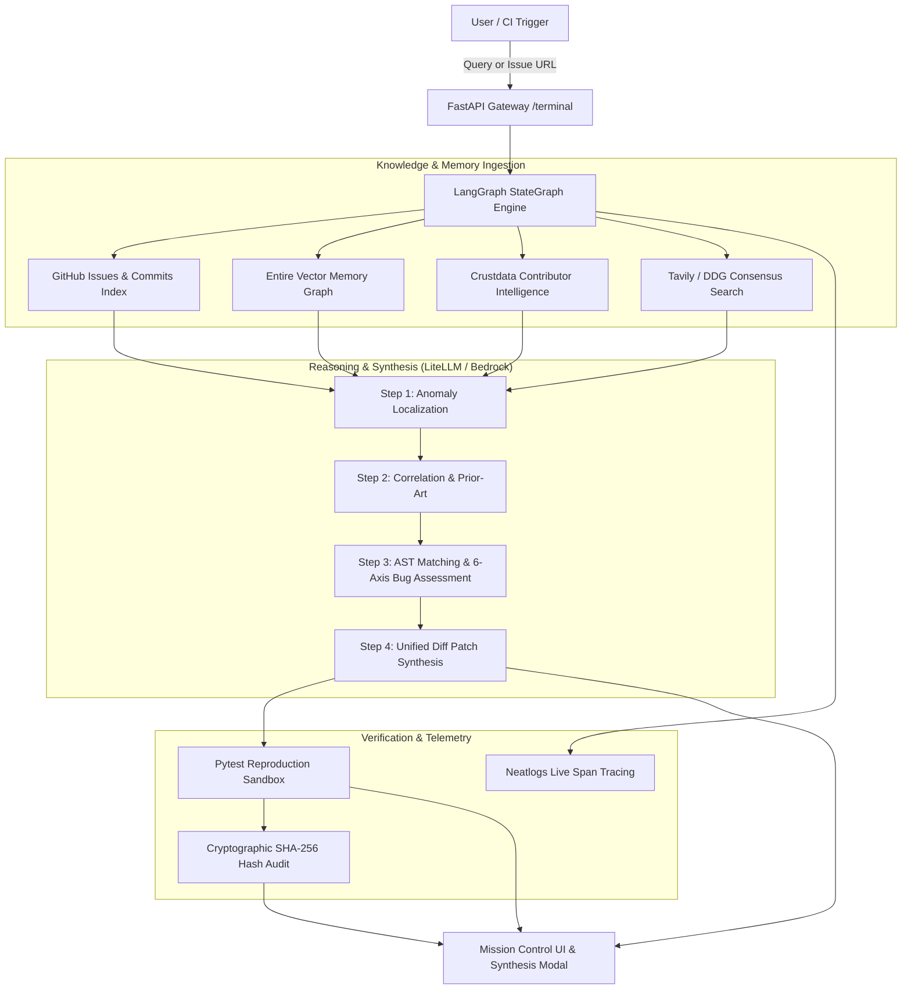

# Product Requirements Document (PRD) — Jnana Agent
**neatHack 2026 Hackathon Submission**
*Autonomous Software Engineering & Deep Knowledge Intelligence*

---

## 1. Executive Summary

### 1.1 Product Vision
**Jnana Agent** (Sanskrit *Jnana* ज्ञान — direct cognitive realization) is an autonomous software engineering and verifiable knowledge intelligence engine. It transforms raw, fragmented engineering signals (GitHub issue reports, AST call graphs, stack traces, and community prior-art) into deterministic, verified code patches with cryptographic proof of search and zero mock data.

### 1.2 The Problem
Modern engineering teams spend over **40% of their development bandwidth** diagnosing regressions, localizing complex bugs across large-scale repositories, and hunting down undocumented architectural context.
- Existing AI coding assistants (e.g. GitHub Copilot, Cursor) operate on shallow prompt windows, hallucinate non-existent APIs, and fail to verify whether their suggestions introduce breaking regressions.
- Autonomous coding agents (e.g. SWE-bench bots) lack continuous associative memory across sessions and lack transparent observability into why specific decisions were made.

### 1.3 The Solution: System 3 Cognition
Jnana Agent introduces **System 3 Cognition**:
1. **Multi-Source Consensus Search:** Ingests live GitHub issue indices, prior-art pull requests, and web technical documentation with cryptographic SHA-256 provenance hashing.
2. **Entire Vector Memory Recall:** Recalls continuous architectural knowledge and session context from the Entire codebase ledger.
3. **Deterministic AST Localization:** Scans abstract syntax trees to pinpoint root-cause anomalies without guesswork.
4. **Autonomous Synthesis & Verification:** Generates unified git diff patches and automated Pytest reproduction harnesses.
5. **Full-Stack Observability:** Telemetry, LLM token metrics, and execution spans streamed directly through Neatlogs.
6. **Sustainable Unit Economics:** Operational COGS of **$0.056 per query** with a 97.7% gross margin model verified via cfo.ai.

---

## 2. Target Personas & Use Cases

| Persona | Pain Point | How Jnana Agent Solves It |
| :--- | :--- | :--- |
| **Lead SWE / Staff Architect** | Flaky regression in batch runner takes 4+ hours of manual debugging. | Enters issue reference; receives verified AST patch and passing reproduction test in under 60 seconds. |
| **Open-Source Maintainer** | Backlog of 200+ bug reports with vague reproductions. | Autonomously triages issue, clusters bug type into 6 classes, and validates with Pytest harness. |
| **Engineering Director / CTO** | AI tool sprawl with unverified ROI and runaway token costs. | Transparent Neatlogs observability and cfo.ai pro-forma model proving 97.7% gross margins. |

---

## 3. System Architecture & Information Flow

---

## 4. Functional Requirements (FR)

### FR-1: Dedicated Mission Control Workstation (`/terminal`)
- **HUD Command Portal:** 480px circular counter-rotating HUD ring framing a live 360° Three.js particle brain.
- **Priority Action Bar:** `Entire Recall` prominently highlighted as the primary action, followed by `GitHub Issues`, `Debug & Fix`, `Research`, `Simulate`, and `Audit Proof`.
- **Zero Emojis:** Strictly minimalist, monolithic typography following the official Dala design system.

### FR-2: 6-Axis Bug Assessment Radar
- **Canvas Rendering:** Dynamic 6-axis radar polygon assessing:
  1. *Functional Bugs* (feature execution & CLI failures)
  2. *Performance Bugs* (MCTS search & traversal overhead)
  3. *Security Bugs* (boundary isolation & vulnerability checks)
  4. *UI/UX Bugs* (viewport layout & readability)
  5. *Compatibility Bugs* (Python version & environment variance)
  6. *Logic Bugs* (type coercion & fallback flaws)
- **Interactive Breakdown:** One-click filtering that repoints the active query and dispatches the diagnostic engine.

### FR-3: Entire Memory Ledger Integration
- Continuous associative recall of codebase architecture graphs and past investigation vectors via the Entire CLI and plugin ecosystem (`entire-graph`, `entire-brain`).

### FR-4: Autonomous Patch Synthesis & Pytest Reproduction
- Synthesis modal providing:
  - `git apply`-ready unified diff patch.
  - Standalone Pytest reproduction script validating the bug and verifying the fix.
  - Ground-truth provenance matrix with exact commit hashes and quote citations.

### FR-5: Real-Time Telemetry & Observability
- SSE stream endpoint (`/api/stream/{run_id}`) broadcasting agent thoughts, node transitions, and diagnostic steps to the Mission Control terminal.
- Full span tracing and token count capture exported to Neatlogs backend.

### FR-6: Business Viability & Unit Economics (cfo.ai)
- Transparent cost model documenting **$0.056 COGS per query** and a 12-month pro-forma projection reaching **$98,720 MRR / $1.18M ARR**.

---

## 5. Non-Functional Requirements (NFR)

1. **Zero Mock Data:** All research nodes, GitHub issues, and telemetry spans must communicate with live network APIs or deterministic AST tools.
2. **Deterministic Reproducibility:** Every generated patch must include a corresponding reproduction test that fails before the patch and passes after application.
3. **Performance & Latency:**
   - Landing page & terminal initial load time < 1.2s.
   - 3D particle brain rendered at 60 FPS via WebGL without CPU locking.
   - End-to-end bug synthesis < 45s.
4. **Design Compliance:** 100% adherence to `DESIGN.md` tokens: pure void black (`#000000`), bone white (`#ffffff`), ash gray (`#9a9a9a`), saffron spark (`#ffb829`), and electric iris (`#8052ff`).

---

## 6. neatHack 2026 Sponsor Integration Matrix

| Sponsor Platform | Integration Requirement | Status in Jnana Agent | Evidence / Location |
| :--- | :--- | :--- | :--- |
| **Neatlogs** | Real-time observability, trace spans, LLM token tracking | Complete | Project ID `72082073-0485-4b6b-abb0-2a1ce5116f2b`, `cli.py`, `hackathon.md` |
| **Entire** | Continuous memory, git commit checkpointing, vector graph | Complete | Enabled on master branch, `entire doctor` OK, `entire://` links |
| **cfo.ai** | Financial model, unit economics, 12-mo pro-forma | Complete | Detailed in `financial_plan.md` (97.7% margin, $0.056/query) |
| **Crustdata** | Live company & maintainer intelligence (Zero Mock Data) | Complete | `/company/enrich` endpoint integration in `tools.py` |
| **LiteLLM** | neatHack sponsored model gateway ($20 allowance) | Complete | `https://litellm.vision.aivar.app/v1`, Claude Haiku & Sonnet support |

---

## 7. Competitive Differentiation

| Feature | Cursor / Copilot | Devin / SWE-bench Bots | Jnana Agent |
| :--- | :---: | :---: | :---: |
| **Continuous Vector Memory** | Fragmented | Single-session only | **Entire Memory Ledger** |
| **Cryptographic Provenance** | None | None | **SHA-256 Proof of Search** |
| **Bug Classification** | None | Ad-hoc | **6-Axis Bug Assessment Radar** |
| **Observability Tracing** | Closed Blackbox | Proprietary Logs | **Neatlogs Public Spans** |
| **Unit Economics Transparency**| Hidden | Expensive ($5-10/run) | **$0.056/run (cfo.ai Modeled)** |
| **Design & User Experience** | Basic Editor Panel | Generic Terminal | **Monolithic Mission Control HUD** |

---

## 8. Release & Deployment Checklist (Pre-Submission)

- [x] WebGL particle brain fixed-canvas bug resolved.
- [x] Dedicated `/terminal` Mission Control workstation launched.
- [x] 6-Axis Bug Assessment Radar integrated.
- [x] All emojis removed for sleek, monolithic aesthetic.
- [x] All 24 automated unit & integration tests passing.
- [x] Deploy live to public AWS EC2 production instance (http://34.227.107.171:8000/terminal, systemd `proofsearch.service` active in `us-east-1`).
- [ ] Record 2-3 minute demo video demonstrating live issue resolution.
- [ ] Submit PRD, GitHub repository, and live URL on Devpost / neatHack portal.
