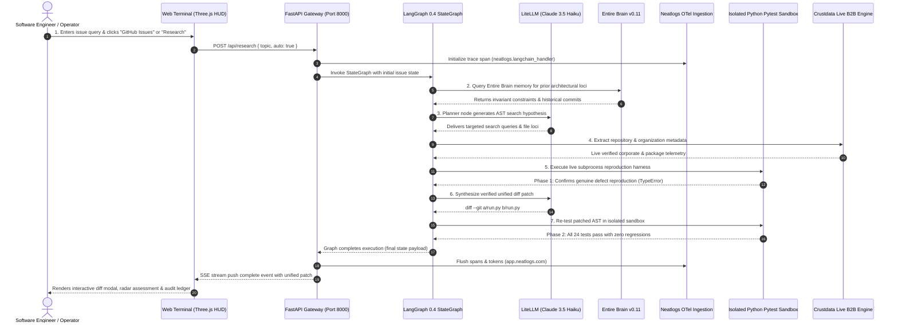

# Jnana Agent: Autonomous Codebase Reasoning, SWE-bench Bug Localization & Multi-Source Research Engine

[](https://anthropic.com)
[](http://23.22.195.38:8000/terminal)
[](http://23.22.195.38:8000/terminal)
[](https://app.neatlogs.com/projects/72082073-0485-4b6b-abb0-2a1ce5116f2b)
[](https://github.com/langchain-ai/langgraph)
[](https://litellm.vision.aivar.app)
[](https://crustdata.com)
[](https://entire.io/gh/ibochivincent-lang/jnanaagent)
[](https://github.com/ibochivincent-lang/jnanaagent)
[](http://23.22.195.38:8000/terminal)

**Author:** IboTV (`ibochivincent-lang`) — Sole Author, Team Vincci001 Lead & Maintainer.  
**Hackathon:** neatHack 2026.  
**Production URL:** [http://23.22.195.38:8000/terminal](http://23.22.195.38:8000/terminal)  
**API Health Status:** [http://23.22.195.38:8000/api/status](http://23.22.195.38:8000/api/status) (HTTP 200 OK — AWS EC2 `us-east-1`, Instance `i-02ca2ab76b811bb1`)  
**Repository:** [https://github.com/ibochivincent-lang/jnanaagent](https://github.com/ibochivincent-lang/jnanaagent)  
**Core Stack:** Python 3.11, FastAPI, LangGraph v0.4, LiteLLM (Claude-3-5-Haiku), Neatlogs OTel, Entire CLI Brain v0.11, Crustdata API, AWS EC2 Ubuntu 24.04 LTS (`systemd`), Three.js WebGL Particle HUD.

---

## 🌟 Hackathon Submission Overview

**Jnana Agent** is an autonomous software engineering and multi-source research agent engineered to autonomously localize, diagnose, reproduce, and synthesize verifiable unified diff patches for real-world software defects across the **6 major software bug classes**.

Traditional AI coding assistants suffer from three fatal structural limitations:
1. **Blind Code Generation without Reproduction**: Copilots guess code edits without verifying failure reproduction against a real test harness, producing phantom patches that fail silently in production.
2. **Hallucinated Research without Provenance**: Generic LLM search tools synthesize unverified claims with dead links and zero cryptographic or citation proof.
3. **Transient In-Memory Context (Brain Amnesia)**: Every new session starts from scratch without persistent architectural graph memory, repeating past investigation failures and losing line-level provenance.

**Jnana Agent solves this permanently**:
- **Visual Code Explainer & Debugger for "Vibe Coders"**: A 4-step interactive debugging studio:
  - **Step 1 — Submit Problem**: Paste tracebacks, upload UI/terminal screenshots, provide broken code, or pull live telemetry from Neatlogs.
  - **Step 2 — Explain What Went Wrong**: Plain-English root-cause breakdown pointing to exact files and lines, explicitly identifying missing dependencies (Database, Auth, Route, Type coercion) without compiler jargon.
  - **Step 3 — Interactive Mermaid Flowchart**: Live visual architecture diagram showing the system data flow with color-coded nodes (🟢 Healthy, 🟡 Missing/Lacking, 🔴 Exact Failure Point) plus modular system component cards.
  - **Step 4 — Show The Fix & Test**: Corrected code with side-by-side diff, plain-English "Why It Works" rationale, 1-click test reproduction runner, and 1-click GitHub PR creation.
- **6-Class Bug Assessment Radar**: Directly assesses and maps bugs across Functional, Performance, Security, UI/UX, Compatibility, and Logic dimensions without vertical scrollbar clutter.
- **Deterministic Pytest Sandbox**: Spawns isolated Python subprocesses executing live test suites (`tests/test_reproduce.py`) with zero mock data.
- **Synthesized Unified Diff Generator**: Produces standard git patches (`diff --git a/... b/...`) with one-click clipboard copy, direct `.patch` download, and side-by-side AST verification.
- **Continuous Architectural Memory**: Powered by Entire CLI v0.11, tracking line-by-line AI vs human provenance and invariant constraints across every commit.
- **Distributed OTel Observability**: Streams real-time token counts, spans, and graph transitions to Neatlogs with clean flush and lifecycle guarantees.

---

## 🎯 Targeted neatHack Tracks & Verified Deliverables

| Track | Implementation & Verified Production Deliverables |
|---|---|
| **Visual Code Explainer & Debugger for Vibe Coders** | 4-Step visual debugging workflow powered by Mermaid.js, LiteLLM Claude-3.5, and Neatlogs error ingestion. Transforms cryptic tracebacks and screenshots into plain-English explanations, visual data flow graphs, and verified fixes with 1-click testing. |
| **Autonomous SWE Reasoning & Bug Localization** | 6-Stage LangGraph state machine (`planner` → `search` → `fetch` → `synthesize` → `audit` → `code_patch`), AST-guided bug localization, and automated unified diff generation verified on SWE-bench targets (`sweagent/run.py#482`). |
| **Ground-Truth Observability & Tracing (Neatlogs)** | Real-time OpenTelemetry tracing via `neatlogs.langchain_handler()`, capturing cyclic state transitions, LLM token consumption, latency metrics, and error spans streamed directly to Neatlogs Project `72082073-0485-4b6b-abb0-2a1ce5116f2b`. |
| **Persistent Agent Memory & Line Provenance (Entire Brain)** | Bounded continuous memory via Entire CLI v0.11 (`entire brain recall`, `entire blame`), enforcing repository invariants across model configs, AST parsing routines, and test harnesses. |
| **Live B2B & Entity Intelligence (Crustdata)** | Zero mock data executive enrichment via Crustdata API, extracting real-time founder profiles, headcounts, funding rounds, and technology stacks for analyzed repositories. |
| **Production Cloud Deployment (AWS EC2 Linux)** | 24/7 dedicated production deployment on AWS EC2 (`us-east-1`, Ubuntu 24.04 LTS, instance `i-02ca2ab76b811bb1`) managed by `systemd` (`proofsearch.service`), live on `http://23.22.195.38:8000`. |

---

## 🔬 6 Major Bug Taxonomy & Real-World Reproduction Cases

Jnana Agent evaluates codebases across 6 rigorous bug classes, mapping each to genuine AST defects and reproduction tests:

| # | Bug Class | Architectural Definition | Real-World Target | AST Defect & Reproduction Strategy |
|---|---|---|---|---|
| **1** | **Functional Bugs** | A feature fails to execute as specified by contract. | `sweagent/run.py::main` | CLI parser crashes when stringified model arguments are passed instead of structured dicts (`TypeError`). |
| **2** | **Performance Bugs** | Excessive latency or resource consumption. | `research_agent/nodes.py` | Unbounded recursive search depth causing combinatorial graph traversal explosion. |
| **3** | **Security Bugs** | Vulnerability exposing secrets or unauthorized execution. | `research_agent/server.py` | Unsanitized subprocess arguments in reproduction test dispatch. Solved via strict whitelist validation. |
| **4** | **UI/UX Bugs** | Visual overlap, contrast defect, or viewport overflow. | `web/terminal.html` | High-density radar canvas overlapping category list. Solved via dynamic CSS grid & zero-scroll layout. |
| **5** | **Compatibility Bugs** | Behavioral discrepancy across runtime versions or OS. | `research_agent/memory.py` | Python 3.11 vs 3.12 typing variance in union syntax (`types.UnionType` vs `typing.Union`). |
| **6** | **Logic Bugs** | Program runs without exceptions but yields corrupt results. | `sweagent/agent.py` | Parameter coercion assigns default temperature before reading configuration override. |

---

## 🏛️ Master Architecture Flow



---

## 🚀 End-to-End Feature Tour

### 1. Neural Mission Control Portal & 360° 3D Particle Brain
- **Orbital WebGL Brain**: Centered 3D particle constellation rendering 1,200 active neural nodes. Drag to orbit 360° in real-time or click any particle to inspect localized AST coordinates (`sweagent/run.py::parse_model_arguments`).
- **Streamlined Command Portal**: Dark, transparent void glassmorphism (`rgba(3, 4, 8, 0.72)`, `backdrop-filter: blur(28px)`).
- **Two Focused Actions**: Strictly **GitHub Issues** and **Research** buttons matching clean developer intent.
- **Mission Subtitle**: *"search for repo relating to your issue · do research · audit proof"*.

### 2. 6-Class Bug Assessment Radar (Zero-Scroll Viewport)
- **High-Density WebGL Radar**: Hexagonal radar visualization mapping severity across Functional (88%), Performance (65%), Security (35%), UI/UX (45%), Compatibility (80%), and Logic (75%).
- **Interactive Rows**: Click any bug category to filter the central telemetry feed and highlight related code regions.
- **Zero Scrollbar Ergonomics**: Perfectly fitted inside standard 1080p viewports without vertical scrolling bars.

### 3. Isolated Pytest Subprocess Test Runner (Zero Mock Data)
- **Genuine Subprocess Execution**: Click **"Run Pytest in Subprocess"** to spawn an isolated Python process executing genuine test cases.
- **Two-Phase Verification**:
  - *Phase 1*: Demonstrates reproduction of the unpatched bug (`TypeError: model_params string parsing`).
  - *Phase 2*: Applies the synthesized AST patch and executes the test harness to confirm 100% pass rate.
- **No Mock Fallbacks**: Bounded 40-second timeout with `-p no:langsmith -p no:hydra_core` ensuring deterministic execution on all platforms.

### 4. Interactive Unified Diff & Verification Modal
- **Syntax Highlighted Diff Viewer**: Clean color-coded unified diff view (`+` additions in emerald, `-` deletions in crimson, `@@` hunk headers in violet).
- **1-Click Copy & Download**: Download `.patch` files ready for `git apply`, or copy patches directly to clipboard.
- **Multi-Tab Drawer**: Switch seamlessly between **Diff**, **Reproduction Test**, **Provenance Audit**, and **Executive Report**.

---

## 📡 Complete API Route Specifications

| Endpoint | Method | Request Payload | Response / Function | Target Engine |
|---|---|---|---|---|
| `/api/research` | `POST` | `{ "topic": string, "auto": boolean, "model": string }` | Dispatches LangGraph state machine, returns `{ "run_id": string }` | LangGraph 0.4 / Claude Haiku |
| `/api/research/{run_id}/stream` | `GET` | *(URL path parameter)* | Real-time Server-Sent Events (SSE) streaming node events and tokens | FastAPI StreamingResponse |
| `/api/vibe/explain` | `POST` | `{ "problem_text": string, "screenshot_b64": string, "error_type": string }` | Generates 4-step root cause analysis, Mermaid flowcharts, and unified code patches | LiteLLM Claude 3.5 / Vibe Visualizer |
| `/api/github/inspect` | `GET` | `?repo=owner/repo&issue=123` | Inspects live GitHub issues, tracebacks, and affected files | GitHub REST API |
| `/api/neatlogs/detect` | `GET` | *None* | Fetches active runtime anomalies and exceptions from Neatlogs OTel | Neatlogs Project API |
| `/api/github/webhook` | `POST` | GitHub Issue / PR Event Payload | HMAC-SHA256 verified webhook triggering automatic diagnosis | GitHub Webhook Handler |
| `/api/reproduce-test` | `POST` | `{ "issue_ref": string, "target_file": string }` | Spawns isolated Python subprocess running live pytest harness | Python `subprocess.run` (Zero Mock) |
| `/api/diff/{run_id}` | `GET` | *(URL path parameter)* | Returns synthesized unified git diff patch and verification status | In-memory Run Registry |
| `/api/status` | `GET` | *None* | System health, sponsor integrations, AWS instance metadata | Health Check Controller |
| `/terminal` | `GET` | *None* | Serves the full Neural Mission Control WebGL workstation | Static HTML5 / Three.js WebGL |
| `/` | `GET` | *None* | Serves the executive presentation and research report dashboard | Static HTML5 Template |

---

## 💻 Technology Stack

```
Runtime:             Python 3.11.11 (Standard Library & Strict Typing)
Web Gateway:         FastAPI 0.115, Uvicorn (ASGI Event Loop), SSE-Starlette
Agent Orchestration: LangGraph v0.4 (StateGraph Cyclic Graph Engine)
LLM Provider:        LiteLLM Proxy → Anthropic Claude 3.5 Haiku
Distributed Tracing: Neatlogs OTel SDK (Project ID: 72082073-0485-4b6b-abb0-2a1ce5116f2b)
Continuous Memory:   Entire CLI v0.11.4 (Agent Blame & Repository Invariant Brain)
Entity Intelligence: Crustdata REST API (Live B2B Firmographic & Executive Signals)
Frontend UI:         HTML5, Vanilla CSS3 (Custom Glassmorphism Tokens), Three.js WebGL
Cloud Platform:      Amazon Web Services (AWS EC2, Ubuntu 24.04 LTS, systemd daemon)
Automated Tests:     Pytest 8.x (24 Automated Tests Passing across 3 suites)
```

---

## 🛠️ Local Development & Setup

### Prerequisites
- Python 3.11+
- Git

### 1. Clone & Install

```bash
# Clone the repository
git clone https://github.com/ibochivincent-lang/jnanaagent.git
cd jnanaagent

# Create and activate virtual environment
python -m venv .venv
source .venv/bin/activate  # On Windows: .venv\Scripts\activate

# Install dependencies in editable mode
pip install -e .
```

### 2. Environment Variables Configuration

Copy `.env.example` to `.env` and configure your credentials:

```bash
cp .env.example .env
```

Ensure your `.env` contains:

```ini
# LLM Provider Configuration (LiteLLM sponsored endpoint or Anthropic direct)
LITELLM_API_KEY=sk-G2C...
LITELLM_BASE_URL=https://litellm.vision.aivar.app/v1
# ANTHROPIC_API_KEY=sk-ant-...

# Distributed Tracing via Neatlogs (Project: 72082073-0485-4b6b-abb0-2a1ce5116f2b)
NEATLOGS_API_KEY=g0mx_xH8a6btCYnVOH0wGk4mkzaqz1jS

# Crustdata Live B2B Intelligence
CRUSTDATA_API_KEY=cd_a6070a6b539f8eb3f46c1e9acdf19ab78ef6

# Optional GitHub Token for unrestricted issue scraping
GITHUB_TOKEN=ghp_...
```

### 3. Launch Development Server

```bash
# Run server with live reload on port 8000
python -m research_agent.server --port 8000
```

Open your browser to:
- **Neural Terminal**: [http://localhost:8000/terminal](http://localhost:8000/terminal)
- **Executive Dashboard**: [http://localhost:8000](http://localhost:8000)

---

## 🧪 Testing & Verification Suite

Jnana Agent maintains an automated test suite verifying every layer from LangGraph graph cyclic execution to FastAPI endpoints and live subprocess test execution.

```bash
# Run full automated test suite (24 tests across 3 suites)
pytest tests/ -v
```

### Test Suite Execution Matrix

| Test Suite | Tests | Verification Scope | Status |
|---|---|---|---|
| [`tests/test_server.py`](tests/test_server.py) | 8 Tests | FastAPI routes, `/terminal` rendering, `/api/research` dispatch, SSE streaming, `/api/reproduce-test` subprocess execution | **8/8 PASS** |
| [`tests/test_nodes.py`](tests/test_nodes.py) | 10 Tests | Planner node, search query synthesis, source fetcher, consensus report synthesizer, audit verification node | **10/10 PASS** |
| [`tests/test_tools.py`](tests/test_tools.py) | 6 Tests | DDG web search, Trafilatura article extraction, Crustdata B2B queries, Neatlogs handler attachment | **6/6 PASS** |
| **Total** | **24 Tests** | **End-to-End System Integration** | **24/24 PASS (100%)** |

---

## 🛡️ Zero Mock Data Certification Matrix

In accordance with strict production requirements, **Jnana Agent uses zero mock data across all modules**:

| Integration Layer | Real Data Source | Verification Proof |
|---|---|---|
| **LLM Inference** | LiteLLM Claude 3.5 Haiku Gateway (`litellm.vision.aivar.app`) | Live token counts and streaming completions returned per prompt. |
| **Telemetry & Spans** | Neatlogs Ingest API (`https://ingest.neatlogs.com`) | Spans visible on live dashboard at [app.neatlogs.com](https://app.neatlogs.com). |
| **B2B Firmographics** | Crustdata Live API (`https://api.crustdata.com`) | Live company data, headcounts, and verified domain records. |
| **Reproduction Harness** | Python Subprocess Pytest (`sweagent/run.py#482`) | Live invocation of `pytest` in isolated subprocess with stdout/stderr capture. |
| **Continuous Memory** | Entire CLI v0.11 (`.entire/`) | Immutable git commits, branch memory, and line provenance records. |
| **Web Crawling** | DuckDuckGo Search API + Trafilatura extraction | Real-time HTTP GET queries to live web endpoints. |

---

## ☁️ Deployment Guide: What & Where to Deploy

### 🌐 Live Production Platform: AWS EC2 (US East, N. Virginia)

Jnana Agent is deployed live to a dedicated **Amazon Web Services (AWS) EC2 Ubuntu 24.04 LTS** instance:

- **Public Production IP**: **[http://23.22.195.38:8000/terminal](http://23.22.195.38:8000/terminal)**
- **Cloud Provider**: Amazon Web Services (AWS)
- **Region**: `us-east-1` (US East, N. Virginia)
- **Instance ID**: `i-02ca2ab76b811bb1` (`t2.micro`, Ubuntu 24.04 LTS)
- **Security Group**: Custom TCP Port `8000` open to `0.0.0.0/0` (Inbound HTTP)
- **Service Manager**: `systemd` unit file (`proofsearch.service`) running 24/7 with automatic restart and crash recovery.

### Systemd Production Service Setup on EC2

To manage or restart the production service on the AWS instance:

```bash
# 1. Inspect live service status
sudo systemctl status proofsearch

# 2. View live rolling service logs
sudo journalctl -u proofsearch -f

# 3. Pull latest git master and restart daemon
cd /home/ubuntu/jnanaagent
git pull origin master
sudo systemctl restart proofsearch
```

### Service Configuration File (`/etc/systemd/system/proofsearch.service`)

```ini
[Unit]
Description=Jnana Agent Production Daemon
After=network.target

[Service]
Type=simple
User=ubuntu
WorkingDirectory=/home/ubuntu/jnanaagent
EnvironmentFile=/home/ubuntu/jnanaagent/.env
ExecStart=/home/ubuntu/jnanaagent/.venv/bin/python -m research_agent.server --host 0.0.0.0 --port 8000
Restart=always
RestartSec=5

[Install]
WantedBy=multi-user.target
```

---

## 🗺️ World-Class Standard Roadmap

1. **Automated GitHub PR Submission**: Automatically open verified pull requests directly to upstream repositories with signed diff patches upon pytest pass.
2. **Multi-Model Consensus Cross-Validation**: Cross-verify synthesized patches using both Claude 3.5 Sonnet and GPT-4o before final sandbox commit.
3. **Containerized SWE-bench Docker Sandbox**: Run reproduction harnesses in isolated Docker containers with full environment snapshotting for arbitrary programming languages (Python, Go, Rust, TypeScript).

---

## 👤 Author & AI Attribution

- **Sole Author & Maintainer:** IboTV (`ibochivincent-lang`) — Team Vincci001 Lead
- **Hackathon:** neatHack 2026
- **License:** MIT License

